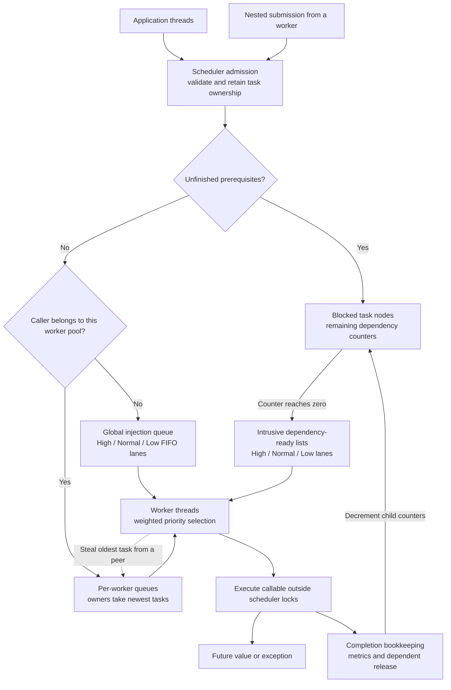
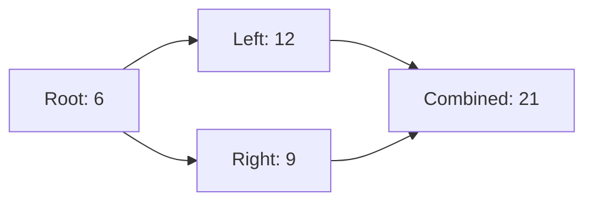

# ThreadForge

[](https://github.com/Ayush-1812/ThreadForge/actions/workflows/ci.yml)
[](CMakeLists.txt)
[](LICENSE)

ThreadForge is a **C++20 multicore task scheduling runtime**. Applications submit
callables to a fixed pool of worker threads, receive futures for their results,
and can declare dependencies between tasks. Workers share uneven workloads by
stealing ready tasks from one another.

The project implements worker-local queues, weighted priorities, dependency
scheduling, runtime metrics, benchmarks, and concurrency hardening. **Phases 1-6
are complete.** Advanced features in Phase 7 remain optional future work.

ThreadForge is a library that runs inside a C++ application. The repository
includes command-line examples, tests, and benchmarks; cloud deployment is not
required to use or demonstrate it.

## Contents

- [Project overview](#project-overview)
- [High-level architecture](#high-level-architecture)
- [Requirements](#requirements)
- [Step-by-step setup](#step-by-step-setup)
- [Run the examples](#run-the-examples)
- [Use ThreadForge in your application](#use-threadforge-in-your-application)
- [Task dependencies](#task-dependencies)
- [Priorities and fairness](#priorities-and-fairness)
- [Metrics and reporting](#metrics-and-reporting)
- [Testing and continuous integration](#testing-and-continuous-integration)
- [Sanitizer builds](#sanitizer-builds)
- [Benchmarks](#benchmarks)
- [Build options](#build-options)
- [Repository layout](#repository-layout)
- [Troubleshooting](#troubleshooting)
- [Lifetime rules and current limits](#lifetime-rules-and-current-limits)
- [Roadmap and further reading](#roadmap-and-further-reading)
- [License](#license)

## Project overview

A single shared task queue is a useful starting point for a thread pool, but
workers submitting new work can concentrate queue traffic and create uneven
loads. ThreadForge gives each worker its own queues and lets idle workers take
work from peers. External callers retain a global submission path.

The runtime also represents task dependencies explicitly. A task waiting for its
prerequisites stays outside the ready queues, leaving worker threads available
for executable work. Completion makes its dependents eligible to run.

| Capability | Behavior |
| --- | --- |
| Fixed worker pool | Owns configurable workers through `std::jthread`; joins every thread |
| Work stealing | Worker-local deques, rotating victims, and a global injection queue |
| Priorities | High, Normal, and Low with conditional 8:4:1 weighted service |
| Dependencies | Completion handles, remaining-prerequisite counters, fan-in, and fan-out |
| Callable submission | Arguments, move-only captures, result futures, and exception propagation |
| Efficient waiting | Condition-variable waiting with a generation predicate |
| Metrics | Lifecycle counts, queue sources, priorities, worker distribution, and optional timings |
| Graceful shutdown | Closes admission, drains accepted work, and joins workers |
| Validation | Deterministic tests, allocation-failure regressions, stress workloads, and sanitizers |
| Benchmarks | Google Benchmark comparisons with sequential execution and a centralized FIFO pool |

The implementation uses mutex-protected queues. Work stealing is a scheduling
strategy; performance depends on task size, submission patterns, and hardware.
Measured comparisons are documented in [docs/benchmarks.md](docs/benchmarks.md).

## High-level architecture



### Main components

| Component | Responsibility |
| --- | --- |
| [`Scheduler`](include/threadforge/scheduler.hpp) | Owns the pool, admits tasks, tracks dependencies, manages wakeups and shutdown |
| [`Worker`](include/threadforge/worker.hpp) | Owns a thread, local queues, service cursors, and per-worker counters |
| [`TaskQueue`](include/threadforge/task_queue.hpp) | Global injection queue; FIFO within each priority lane |
| [`WorkStealingQueue`](include/threadforge/work_stealing_queue.hpp) | Local priority deques; owner consumes newest work and thieves consume oldest work |
| [`Task`](include/threadforge/task.hpp) | Move-only callable wrapper using `std::packaged_task<void()>` |
| [`TaskHandle`](include/threadforge/task_handle.hpp) | Copyable completion token used to declare prerequisites |
| [`MetricsSnapshot`](include/threadforge/metrics.hpp) | Aggregate and per-worker telemetry |

### What happens to a submitted task?

1. **Admission:** the scheduler validates priority and dependency ownership,
   creates task state, and retains accepted work independently of its future.
2. **Readiness:** a task with unfinished prerequisites stays blocked. A ready
   task submitted externally enters the global queue; a ready nested submission
   enters the current worker's queue when it targets the same scheduler.
3. **Selection:** a worker chooses a priority class using its service cursor.
   Within that class, it checks its local queue, the global injection queue, the
   dependency-ready list, then other workers' queues.
4. **Execution:** the worker releases queue locks before invoking application
   code. The result or exception is stored in the task's future.
5. **Completion:** the scheduler updates accounting and decrements dependency
   counters. Newly ready dependents enter allocation-free intrusive ready lists.
6. **Waiting:** when no task is claimable, a worker sleeps on a condition
   variable. A wake-generation predicate handles publication during the gap
   between scanning queues and beginning to wait.

The global injection lanes and dependency-ready lists are separate FIFO sources;
they do not provide a single FIFO order across both. Admission can also use the
intrusive lists as a fallback when an ordinary ready deque cannot allocate.

The scheduler state mutex protects graph registration, completion, and pending
gauges. Each queue has its own mutex, external shutdown callers share a join
mutex, and workers expose counters through atomics. During startup failure,
already-started workers are joined before their shared queue registry is destroyed.
See [docs/architecture.md](docs/architecture.md) for synchronization details.

## Requirements

**Validated platform:** Ubuntu 24.04, directly on Linux or through WSL2 on Windows.
CI covers GCC 13 and Clang 18. Native Windows and macOS have not been validated.

| Dependency | Required for |
| --- | --- |
| C++20 compiler and standard library | All builds, including `std::jthread`, futures, and C++20 synchronization |
| CMake 3.20 or newer | Configuration and building |
| Ninja | The build commands in this guide |
| Git | Cloning the repository |
| GoogleTest | Default test and stress-test builds |
| Python 3 | Benchmark reports and the optional benchmark-summary test entry |
| Google Benchmark | Optional performance benchmarks |

GoogleTest and Google Benchmark are resolved from installed packages with CMake
`find_package`. Configuration does not download these dependencies. You can
disable tests or benchmarks when embedding only the runtime.

## Step-by-step setup

### 1. Open a supported development environment

**Ubuntu users:** open a terminal and continue to step 2.

**Windows users:** use an Ubuntu terminal through WSL2. For a new installation,
open PowerShell as Administrator and run:

```powershell
wsl --list --online
wsl --install -d Ubuntu-24.04
```

Restart if Windows requests it, then launch Ubuntu and create its Linux username
and password. These steps follow the official
[Microsoft WSL installation guide](https://learn.microsoft.com/en-us/windows/wsl/install)
and [Ubuntu WSL guide](https://ubuntu.com/wsl/docs/latest/howto/install-ubuntu-wsl2/).

If WSL is already installed, inspect the registered distribution names:

```powershell
wsl --list --verbose
wsl -d Ubuntu-24.04
```

Use the name printed on your machine. For example, an existing distribution
registered as `Ubuntu` is opened with `wsl -d Ubuntu`.

The `VERSION` column should show `2`. If an existing installation shows `1`,
convert it from PowerShell before continuing, using its registered name:

```powershell
wsl --set-version Ubuntu-24.04 2
```

**Run the remaining setup commands inside Ubuntu.** Linux tools installed with
`apt` are available in that shell; installing them does not add Windows-native
tools to the PowerShell PATH. Older MinGW installations, including GCC 6.3,
cannot build this C++20 project.

### 2. Install build dependencies

```bash
sudo apt-get update
sudo apt-get install -y \
  build-essential cmake ninja-build git libgtest-dev python3
```

For the optional benchmark suite, also install:

```bash
sudo apt-get install -y libbenchmark-dev
```

Check the tools before configuring:

```bash
g++ --version
cmake --version
ninja --version
python3 --version
```

The recorded local environment uses GCC 13.3.0 and CMake 3.28.3. A compiler must
support C++20 in both its language frontend and standard library.

### 3. Get the source

```bash
cd ~
git clone https://github.com/Ayush-1812/ThreadForge.git
cd ThreadForge
```

For a fresh WSL checkout, clone in your Linux home directory. If you already
have the repository on a Windows drive, open that directory instead. For example,
`C:\Users\Your Name\ThreadForge` is accessible from Ubuntu as:

```bash
cd "/mnt/c/Users/Your Name/ThreadForge"
```

Replace the example path with yours and keep quotes around paths containing
spaces. You should now see `CMakeLists.txt`, `include/`, `src/`, and `tests/`.

### 4. Configure and build

Run from the repository root:

```bash
cmake -S . -B build-release -G Ninja \
  -DCMAKE_BUILD_TYPE=Release \
  -DTHREADFORGE_WARNINGS_AS_ERRORS=ON

cmake --build build-release --parallel 1
```

`-S .` selects the source directory; `-B build-release` keeps generated files in
an ignored build directory. Release enables optimization, and warnings-as-errors
checks ThreadForge's own targets. One compiler job limits resource use; increase
the parallel count if your machine has sufficient memory and disk space.

This default configuration builds the runtime, five examples, focused tests, and
stress tests. Google Benchmark remains disabled until you enable it explicitly.
If your existing build directory has cached options from another configuration,
check them with `cmake -LA -N build-release` or choose a new build directory.

### 5. Run the tests

```bash
ctest --test-dir build-release --output-on-failure --parallel 1
```

With Python 3 and the default test options enabled, the expected summary is:

```text
100% tests passed, 0 tests failed out of 150
```

Those 150 CTest entries contain 149 C++ cases and one entry that runs 13 Python
unit cases. Without a discovered Python interpreter, CTest lists 149 entries.
Disabling stress tests reduces the count. Runtime and test duration depend on
your machine.

### 6. Run your first example

```bash
./build-release/threadforge_basic
```

Expected output:

```text
Answer: 42
Sum: 30
```

At this point you have built the library, checked its tests, and executed tasks
through the scheduler.

## Run the examples

Run these commands from the repository root after the default build:

| Command | Demonstrates |
| --- | --- |
| `./build-release/threadforge_basic` | Submit callables and arguments; retrieve future results |
| `./build-release/threadforge_work_stealing` | Nested fan-out, local work, and peer stealing |
| `./build-release/threadforge_priorities` | Deterministic priority selection with a gated worker |
| `./build-release/threadforge_dependency_graph` | A one-worker diamond graph with fan-out and fan-in |
| `./build-release/threadforge_metrics_report` | Settled counters, timing fields, and a readable report |

Useful checks when you run them:

- The work-stealing example prints checksum `357389824` and 1,025 submitted
  tasks. Local and stolen counts vary between runs.
- The priority example prints `High`, `Normal`, and `Low` in that order because
  it establishes readiness with a gate. Arbitrary concurrent tasks do not have
  a fixed execution order.
- The dependency example prints `Root: 6`, `Left: 12`, `Right: 9`, and
  `Combined: 21`.
- The metrics example prints checksum `358438400`, 1,025 completed tasks, zero
  callable failures, and zero final pending, ready, running, and blocked gauges.
  Timings, steal totals, and worker distribution vary.

Source files are in [examples/](examples/).

## Use ThreadForge in your application

### Submit a task and retrieve its result

This is a complete C++ program:

```cpp
#include <threadforge/scheduler.hpp>

#include <iostream>

int main() {
    threadforge::Scheduler scheduler(4);

    auto answer = scheduler.submit([] { return 42; });
    auto sum = scheduler.submit([](int a, int b) { return a + b; }, 10, 20);

    std::cout << "Answer: " << answer.get() << '\n';
    std::cout << "Sum: " << sum.get() << '\n';
    scheduler.shutdown();
}
```

`submit()` stores the callable and arguments, then returns a
`std::future<Result>`. The calling thread can do other work before calling
`get()`. If the callable throws, `get()` rethrows its exception; the worker stays
available for subsequent tasks.

Move-only captures and arguments are supported. Stored arguments are moved for
invocation; use `std::ref` for an explicit reference argument and keep the
referenced object alive until the task finishes.

### Link the library with CMake

For a small consuming project, use this directory layout:

```text
my-app/
  CMakeLists.txt
  main.cpp
  external/
    ThreadForge/
```

Clone ThreadForge into the consuming project's `external` directory:

```bash
mkdir -p external
git clone https://github.com/Ayush-1812/ThreadForge.git external/ThreadForge
```

Put the complete program above in `main.cpp`, then create this `CMakeLists.txt`:

```cmake
cmake_minimum_required(VERSION 3.20)
project(ThreadForgeDemo LANGUAGES CXX)

set(THREADFORGE_BUILD_TESTS OFF CACHE BOOL "" FORCE)
set(THREADFORGE_BUILD_EXAMPLES OFF CACHE BOOL "" FORCE)
set(THREADFORGE_BUILD_BENCHMARKS OFF CACHE BOOL "" FORCE)
add_subdirectory(external/ThreadForge)

add_executable(threadforge_demo main.cpp)
target_link_libraries(threadforge_demo PRIVATE threadforge::threadforge)
```

Build and run from `my-app/`:

```bash
cmake -S . -B build -G Ninja -DCMAKE_BUILD_TYPE=Release
cmake --build build --parallel 1
./build/threadforge_demo
```

The target propagates its C++20 requirement, include paths, and thread linkage.
Its warning policy stays private to project targets. Embedding with tests and
benchmarks disabled does not require GoogleTest or Google Benchmark. The current
repository supports `add_subdirectory`; installed-package exports and
`find_package(ThreadForge)` are not provided.

## Task dependencies

`submit_task()` returns both a future and a completion handle. Use
`submit_after()` to declare which tasks must finish before a new task runs.
Futures carry values and exceptions; handles describe graph edges.



Inside a program that includes `<threadforge/scheduler.hpp>`:

```cpp
threadforge::Scheduler scheduler(1);

auto root = scheduler.submit_task([] { return 6; });
auto root_value = root.future.share();

auto left = scheduler.submit_after({root.handle}, [root_value] {
    return root_value.get() * 2;
});
auto right = scheduler.submit_after({root.handle}, [root_value] {
    return root_value.get() + 3;
});

auto left_value = left.future.share();
auto right_value = right.future.share();
auto combined = scheduler.submit_after(
    {left.handle, right.handle}, threadforge::Priority::High,
    [left_value, right_value] {
        return left_value.get() + right_value.get();
    });

int result = combined.future.get(); // 21; called by the external thread.
scheduler.shutdown();
```

Even with one worker, the graph runs because blocked dependents consume no
worker. Each dependent reads only results whose handles it declared, so those
futures are already ready when its callable executes.

Dependencies must belong to the same scheduler. Duplicate handles count once,
and completed prerequisites are already satisfied. Invalid, foreign, or stale
handles are rejected. Edges point from existing tasks to newly submitted tasks,
so the submission API cannot create a cycle by modifying an existing graph.

A failed prerequisite still releases its dependents. A child decides whether
to read and propagate the exception, handle it, or run without reading the
result. Failure does not automatically cancel descendants. Capturing a future
without declaring its handle does not register a dependency.

The complete runnable version is
[examples/dependency_graph.cpp](examples/dependency_graph.cpp); API contracts are
in [docs/dependencies.md](docs/dependencies.md).

## Priorities and fairness

Pass a priority before the callable:

```cpp
auto urgent = scheduler.submit(threadforge::Priority::High, [] { return 42; });
auto ordinary = scheduler.submit([] { return 7; }); // Normal by default.
auto background = scheduler.submit(threadforge::Priority::Low, [] {});
```

Each worker uses a ring of eight High slots, four Normal slots, and one Low
slot. Empty classes are skipped, so ready work can still run when another class
is empty. When all three classes remain claimable, the worker serves them in an
8:4:1 ratio per 13 claims. Priority selection happens before queue-source
selection; a preferred global High task can therefore precede a local Low task.

These are class-service opportunities, not wall-time or individual-task latency
guarantees. Running tasks are never preempted. Local LIFO selection and source
preference can postpone particular tasks under a continuous workload. Priorities
are explicit and are not inherited by nested submissions.

See [docs/priorities.md](docs/priorities.md) for the policy and fairness limits.

## Metrics and reporting

Counters are always available. Enable optional steady-clock timings when
constructing the scheduler:

```cpp
#include <threadforge/metrics.hpp>
#include <threadforge/scheduler.hpp>

#include <iostream>

int main() {
    threadforge::Config config;
    config.worker_count = 4;
    config.enable_timing = true;
    threadforge::Scheduler scheduler(config);

    auto result = scheduler.submit([] { return 42; });
    static_cast<void>(result.get());
    scheduler.shutdown();

    threadforge::write_metrics(std::cout, scheduler.metrics());
}
```

Reports include submitted, started, completed, and failed counts; High/Normal/Low
totals; local, global, and stolen claims; failed steal probes; wait episodes; and
worker distribution. Optional durations cover execution, queue waiting,
dependency waiting, and idle waits.

The pending gauges form a synchronized partition:

```text
tasks_pending = tasks_ready + tasks_running + tasks_waiting_dependencies
```

After `shutdown()` returns, accepted tasks have drained and the settled totals
satisfy:

```text
tasks_submitted = tasks_started = tasks_completed
tasks_completed = local_tasks + global_tasks + tasks_stolen
tasks_failed <= tasks_completed
tasks_pending = tasks_ready = tasks_running = tasks_waiting_dependencies = 0
```

Live snapshots are observational across independently read worker counters.
`future.get()` can return before the final completion-counter update; call
`shutdown()` before checking settled totals. Timing is disabled by default and
adds clock-read overhead when enabled. Callable failure accounting is distinct
from exceptions during result storage, as explained in
[docs/metrics.md](docs/metrics.md).

## Testing and continuous integration

The current suite includes 104 focused C++ cases, of which three run in a
separate allocation-injection executable, and 45 stress cases. With Python
available, an additional CTest entry runs 13 standard-library Python unit cases
for benchmark-report handling.

Coverage includes concurrent producers, worker-local fan-out, stealing,
deterministic priorities, dependency races, move-only ownership, exception
propagation, reentrant capture destruction, allocation failure, shutdown races,
and concurrent metrics snapshots. Stress workloads exercise 100,000 tasks and
100,000-node graphs at 1, 2, 4, and 8 workers, checking exact execution counts and
checksums.

Run specific groups from an existing default build:

```bash
# Focused checks and the Python report check.
ctest --test-dir build-release -LE stress --output-on-failure

# Heavier stress cases.
ctest --test-dir build-release -L stress --output-on-failure

# Isolated allocation-failure cases.
ctest --test-dir build-release -L allocation --output-on-failure

# Python report checks independently.
python3 tests/test_benchmark_summary.py
```

The [GitHub Actions workflow](.github/workflows/ci.yml) builds with
warnings-as-errors and runs the complete suite on Ubuntu 24.04:

| Lane | Additional checks |
| --- | --- |
| GCC 13 Debug | Unoptimized runtime, tests, and examples |
| GCC 13 Release | Optimized build, examples, benchmark checksum smoke, and report validation |
| Clang 18 Release | Second-compiler coverage and examples |
| GCC 13 ASan + UBSan | Address and undefined-behavior checks plus examples |
| GCC 13 TSan | ThreadSanitizer concurrency checks |

All five lanes passed the final Phase 6 code, including fixes for a partial
worker-startup teardown race and an allocation-test fixture mismatch. The
[validation record](docs/validation.md) links the verified hosted run and records
local configurations. Passing tests establish results for the exercised paths;
they do not establish application-specific speedups.

## Sanitizer builds

Use separate build directories with GCC or Clang. To check memory errors and
undefined behavior:

```bash
cmake -S . -B build-asan -G Ninja -DCMAKE_BUILD_TYPE=Debug \
  -DTHREADFORGE_WARNINGS_AS_ERRORS=ON \
  -DTHREADFORGE_ENABLE_ASAN=ON -DTHREADFORGE_ENABLE_UBSAN=ON
cmake --build build-asan --parallel 1
ctest --test-dir build-asan --output-on-failure --parallel 1
```

To check data races:

```bash
cmake -S . -B build-tsan -G Ninja -DCMAKE_BUILD_TYPE=Debug \
  -DTHREADFORGE_WARNINGS_AS_ERRORS=ON -DTHREADFORGE_ENABLE_TSAN=ON
cmake --build build-tsan --parallel 1
ctest --test-dir build-tsan --output-on-failure --parallel 1
```

ASan and TSan cannot be enabled together; configuration rejects that combination.
The selected sanitizer must compile and link during a support probe, and its
instrumentation propagates to linked project executables. System GoogleTest and
Google Benchmark packages remain prebuilt dependencies.

Some WSL address layouts fail before executing a TSan test with
`FATAL: ThreadSanitizer: unexpected memory mapping`. The recorded local
environment uses this per-process workaround:

```bash
setarch "$(uname -m)" -R ctest --test-dir build-tsan --output-on-failure --parallel 1
```

Try ordinary CTest first. Apply the workaround only to a confirmed startup
mapping failure, and treat actual sanitizer findings as failures. It changes
address randomization for that process and its children; no global kernel
setting is needed. Runners that prohibit `setarch` may still be unable to start
TSan. Full commands and environment notes are in
[docs/hardening.md](docs/hardening.md) and [docs/validation.md](docs/validation.md).

## Benchmarks

Install `libbenchmark-dev` and Python 3 using the setup steps above. Then, from
the repository root, run:

```bash
bash scripts/run_benchmarks.sh
```

The script builds an optimized benchmark-only configuration and writes:

| File | Contents |
| --- | --- |
| `benchmark-results/environment.txt` | Host, compiler/build information, and sampling arguments |
| `benchmark-results/results.raw.json` | Original Google Benchmark output |
| `benchmark-results/results.json` | Portable JSON with undefined nonfinite values normalized |
| `benchmark-results/summary.md` | Batch times and matched sequential speedups |

The suite has **54 cases** comparing sequential execution, a centralized FIFO
thread pool, and ThreadForge. Workloads cover uniform external submissions and
uneven nested fan-out at 1, 2, 4, and 8 workers. Every case verifies the same
CPU-work checksum across implementations.

For a short correctness smoke run covering all cases:

```bash
bash scripts/run_benchmarks.sh benchmark-results/smoke \
  --benchmark_min_warmup_time=0.01 \
  --benchmark_min_time=0.01s \
  --benchmark_repetitions=1
```

For sustained measurements, the default runner uses a 0.1-second warmup,
0.2-second minimum measurement time, and five repetitions. You can select the
output directory and override those sampling arguments. Set
`THREADFORGE_BENCHMARK_BUILD_DIR` to choose a build directory and
`THREADFORGE_BUILD_JOBS` to change the default one compiler job.

Benchmark timing includes submission, CPU work, and waiting for results. Pool
construction and final shutdown are excluded. A short smoke run checks
correctness and report generation; reliable performance conclusions require
longer measurements on a controlled host. The runtime adds overhead for very
small tasks and does not always outperform the simpler centralized baseline.
The [benchmark guide](docs/benchmarks.md) records a measured WSL sample, exact
timing boundaries, and interpretation limits.

## Build options

Pass options to configuration as `-DOPTION=ON` or `-DOPTION=OFF`:

| Option | Default | Purpose |
| --- | --- | --- |
| `THREADFORGE_BUILD_TESTS` | `ON` | Build GoogleTest executables and optional Python CTest entry |
| `THREADFORGE_BUILD_EXAMPLES` | `ON` | Build five command-line examples |
| `THREADFORGE_BUILD_STRESS_TESTS` | `ON` | Build heavier cases when tests are enabled |
| `THREADFORGE_BUILD_BENCHMARKS` | `OFF` | Build the optional Google Benchmark executable |
| `THREADFORGE_WARNINGS_AS_ERRORS` | `OFF` | Treat project warnings as errors |
| `THREADFORGE_ENABLE_ASAN` | `OFF` | Enable AddressSanitizer |
| `THREADFORGE_ENABLE_UBSAN` | `OFF` | Enable UndefinedBehaviorSanitizer |
| `THREADFORGE_ENABLE_TSAN` | `OFF` | Enable ThreadSanitizer |

For a smaller library-and-examples build without test dependencies:

```bash
cmake -S . -B build-minimal -G Ninja -DCMAKE_BUILD_TYPE=Release \
  -DTHREADFORGE_BUILD_TESTS=OFF -DTHREADFORGE_BUILD_BENCHMARKS=OFF
cmake --build build-minimal --parallel 1
```

## Repository layout

```text
ThreadForge/
  CMakeLists.txt                 Build targets, warnings, and sanitizer options
  include/threadforge/          Public runtime headers and worker declarations
  src/                          Scheduler, workers, queues, and metrics
  examples/                     Five runnable demonstrations
  tests/                        Focused, stress, allocation, and report tests
  benchmarks/                   Google Benchmark suite and centralized baseline
  scripts/                      Benchmark runner and report normalization
  docs/                         Architecture, API contracts, and validation
  .github/workflows/ci.yml       GCC/Clang and sanitizer CI matrix
  LICENSE                       MIT license
```

Generated `build*/` and top-level `benchmark-results/` directories are ignored
by Git. The published measured sample under `docs/benchmark-results/` is tracked.

## Troubleshooting

| Symptom | What to check |
| --- | --- |
| `cmake`, `ninja`, or `g++` is not found | Install the setup packages inside Ubuntu and use that terminal |
| Compiler rejects `-std=c++20` or lacks `std::jthread` | Use a compiler and standard library with C++20 support; the tested combinations are GCC 13 and Clang 18 on Ubuntu 24.04 |
| CMake cannot find GoogleTest | Install `libgtest-dev`, or configure `THREADFORGE_BUILD_TESTS=OFF` for a runtime-only build |
| CMake cannot find Google Benchmark | Install `libbenchmark-dev`, or keep `THREADFORGE_BUILD_BENCHMARKS=OFF` |
| A path containing spaces cannot be opened | Quote the complete path, including Windows paths mounted under `/mnt/c/` |
| CMake reports a generator or compiler mismatch | Use a new build directory when changing generators or compiler toolchains |
| Fewer than 150 CTest entries appear | Check Python detection and whether tests/stress tests are enabled in the cached configuration |
| No tests appear | Reconfigure with `THREADFORGE_BUILD_TESTS=ON`, then build the test targets |
| An example executable is missing | Configure `THREADFORGE_BUILD_EXAMPLES=ON`, then rebuild |
| TSan reports an unexpected memory mapping before tests run | See the sanitizer startup workaround above; do not suppress race reports |
| Metrics totals change after `future.get()` | Call `shutdown()` before relying on settled counts |
| A task or shutdown hangs | Ensure worker tasks terminate and do not wait on unfinished work queued to the same saturated pool |
| Compilation fails for lack of memory or disk | Build with one compiler job and keep sufficient space for generated objects, especially Debug/sanitizer builds |

When reporting a problem, include the compiler version, OS, configuration
command, failing command, and its complete diagnostic. For a failed test,
include CTest's output and the smallest code sample that reproduces it.

## Lifetime rules and current limits

- Choose a worker count when constructing the scheduler. The default uses
  `std::thread::hardware_concurrency()` with a one-worker fallback; explicit zero
  is rejected.
- Keep the scheduler and any reference-captured application data alive while
  tasks or concurrent API calls can use them.
- `shutdown()` is idempotent and supports concurrent external callers. It closes
  new admissions, drains accepted ready and dependency-blocked tasks, and joins
  workers. `is_shutdown()` reports admission closure, which can precede finished
  joins.
- Call shutdown and destroy the scheduler from its external owner. Calling
  shutdown from one of its own workers throws `std::logic_error`; destroying it
  from such a worker is unsupported.
- Submissions after closure throw `std::runtime_error`, including nested
  submissions attempted during draining. A submission racing closure is either
  accepted and drained or rejected.
- Discarding a future or completion handle does not cancel accepted work.
- Avoid waiting on unfinished same-pool tasks from workers. Use declared
  dependencies or return child futures to an external caller. Arbitrary future
  waits do not provide cooperative execution.
- Queues are mutex-protected, admission is unbounded, and graceful shutdown
  requires user tasks to return. There are no task timeouts, cancellation,
  preemption, or guaranteed individual-task latency bounds.
- Validation currently covers Linux/WSL; native Windows, macOS, and alternative
  standard-library configurations remain unvalidated.

## Roadmap and further reading

| Phase | Scope | Status |
| --- | --- | --- |
| 1 | Basic runtime and lifecycle | Complete |
| 2 | Worker-local queues and work stealing | Complete |
| 3 | Priorities and fairness policy | Complete |
| 4 | Dependency-aware scheduling, fan-in, and fan-out | Complete |
| 5 | Metrics, centralized baseline, and benchmarks | Complete |
| 6 | Stress tests, sanitizer checks, strict warnings, documentation, and CI | Complete |
| 7 | Optional advanced features | Future scope; requires an explicit feature request |

Potential Phase 7 work includes cancellation, timeouts, CPU affinity, custom
allocators, coroutine integration, reduced-lock queues, NUMA awareness, and GPU
task integration. These features are not implemented automatically.

| Document | Read it for |
| --- | --- |
| [Architecture](docs/architecture.md) | Ownership, queue routing, synchronization, and waiting |
| [Scheduler API](docs/scheduler.md) | Submission overloads, futures, handles, and shutdown contracts |
| [Priorities](docs/priorities.md) | Weighted selection and conditional fairness |
| [Dependencies](docs/dependencies.md) | Graph semantics and failure handling |
| [Metrics](docs/metrics.md) | Counter meanings, timing boundaries, and settled invariants |
| [Benchmarks](docs/benchmarks.md) | Methodology, measurement commands, and recorded sample |
| [Hardening](docs/hardening.md) | Test selection, sanitizer configuration, and CI scope |
| [Validation](docs/validation.md) | Verified local/hosted results and environment limitations |

## License

ThreadForge is available under the [MIT license](LICENSE).
