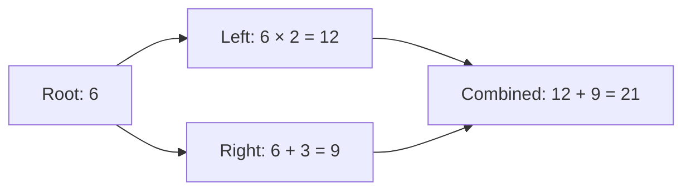

# Dependency scheduling: Phase 4

ThreadForge can keep a task out of its ready queues until its prerequisites
finish. Dependencies express completion, while futures carry results and
exceptions. The scheduler releases a dependent task without occupying a worker
to wait for its prerequisites.

Include `<threadforge/scheduler.hpp>`. `submit_task()` returns a
`threadforge::TaskSubmission<Result>` containing a result `future` and a
completion `handle`:

```cpp
auto root = scheduler.submit_task([] { return 6; });
auto root_result = root.future.share();
auto child = scheduler.submit_after({root.handle}, [root_result] {
    return root_result.get() * 2;
});
auto answer = child.future.get();
```

The child is only made ready after the root completes, so its `get()` reads an
already-ready prerequisite result. Declaring the handle dependency is essential:
capturing a future alone does not tell the scheduler about an edge.

## API and handles

| Call | Return value |
| --- | --- |
| `submit(callable, args...)` | `std::future<Result>` |
| `submit(Priority, callable, args...)` | `std::future<Result>` |
| `submit_task(callable, args...)` | `TaskSubmission<Result>` |
| `submit_task(Priority, callable, args...)` | `TaskSubmission<Result>` |
| `submit_after(dependencies, callable, args...)` | `TaskSubmission<Result>` |
| `submit_after(dependencies, Priority, callable, args...)` | `TaskSubmission<Result>` |

Dependencies accept a `std::span<const TaskHandle>` or an initializer list of
handles. Empty dependencies behave like ordinary ready submission. All overloads
without an explicit priority use `Priority::Normal`; a child does not inherit
its parent's priority. Callable and argument storage, reference lifetimes, and
future result types follow the existing [scheduler API](scheduler.md).

A `TaskHandle` is a copyable completion token, not a result future. Its `valid()`
method checks that the token is nonempty and its scheduler owner is still alive.
It does not indicate that the task is unfinished or admission remains open;
handles remain valid after shutdown while their scheduler lives. A valid
handle from another scheduler is still rejected by the receiving scheduler.
Dependencies must refer to tasks accepted by the same scheduler. Default,
foreign, and stale handles cause `std::invalid_argument`, and the new task is
not accepted. Duplicate handles are treated as one prerequisite. A completed
task's handle can be reused while its scheduler remains alive; that prerequisite
is already satisfied.

Keep captured references and pointed-to data alive until the callable finishes.
Copying a handle extends the token's lifetime, not the lifetime of application
data. The scheduler keeps accepted graph nodes alive independently of whether
the caller retains their handles or futures; dropping either does not cancel
an accepted task.

## Graph shape and failures

The API adds edges only when submitting a new task, from handles for already
accepted prerequisites. It provides no operation to mutate an existing task's
dependencies. Every edge therefore points from an older accepted task to a new
task, which prevents cycles through this API. It does not prevent deadlocks
created by user locks or waits on unrelated futures.

A prerequisite is complete when its callable finishes, whether it returns a
value or throws. A failed parent releases its dependents. Each child decides
whether to read the parent's result, recover from its exception, or run without
reading it. If a child calls `get()` on a failed prerequisite's ready future,
that exception propagates into the child's own result future unless caught.
Failure does not automatically cancel a branch or skip descendants.

Only futures corresponding to declared, completed prerequisites are guaranteed
ready when a dependent runs. Waiting on other queued tasks can still consume all
workers and deadlock. Dependency scheduling does not add cooperative waiting to
arbitrary `future.get()` calls.

## Diamond example

[`examples/dependency_graph.cpp`](../examples/dependency_graph.cpp) uses one
worker to compute a diamond without blocking a worker on unfinished work:



The root and children expose shared result futures for multiple readers. The
fan-in declares both child handles and explicitly requests `Priority::High`.
The main thread waits for the combined result and then drains the scheduler.
The example prints the four values in a fixed order; the sibling tasks' relative
execution order is unspecified.

## Readiness, waiting, and shutdown

The scheduler state mutex protects dependency registration, completion state,
and remaining-prerequisite counts. Registration and completion use the same
lock, so a parent that finishes during submission cannot leave its child waiting
for an already-completed event. A task is made ready once after its last unique
prerequisite completes.

Newly submitted ready tasks retain the existing worker-local or global routing.
Tasks released by dependency completion enter intrusive priority ready lists;
promotion does not allocate memory. Ready admission also falls back to those
lists if growing an ordinary ready deque fails. For a selected priority, a worker
checks its local lane, the global injection lane, the intrusive ready list, and
then victim lanes. Released tasks count as global claims in the existing
metrics. The [weighted priority policy](priorities.md) still chooses the class
before this source order. Injection tasks can precede released tasks of the
same class; there is no FIFO guarantee spanning these separate sources.

Workers wait for a generation change when no task is ready, including during
shutdown while accepted prerequisites are still running. Completion that makes
work ready wakes waiting workers. Closing submissions does not cause idle
workers to spin while accepted tasks remain.

Graceful shutdown rejects new submissions and drains every accepted task,
including children that were blocked at closure. Those children become ready
as their accepted prerequisites finish. Joining the workers waits for the whole
accepted graph to complete. A future or handle can outlive shutdown, although
the closed scheduler accepts no new dependents. After scheduler destruction,
retained handles are stale; result futures retain their standard result
ownership. There is no cancellation or forced interruption, so accepted
callables must terminate for shutdown to finish.

Graph nodes, prerequisite registrations, and shared result state add memory and
allocation costs to submission. Registration and completion share the scheduler
state mutex, while ready-task queue access retains its queue locks. These are
correctness tradeoffs; no lock-free behavior or performance improvement is
claimed without measurement.
